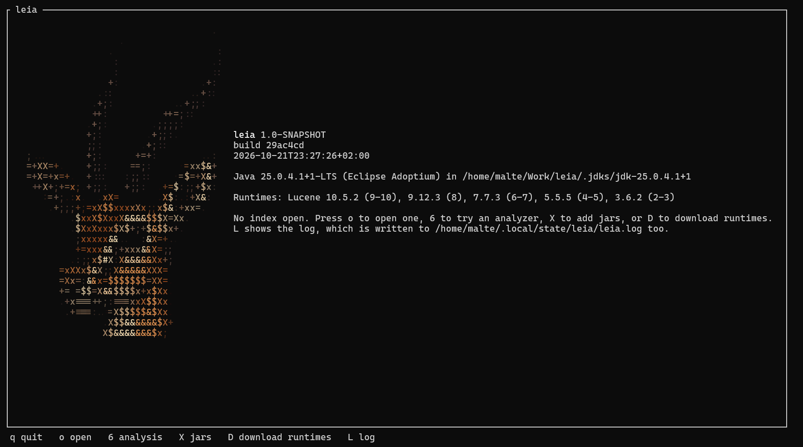
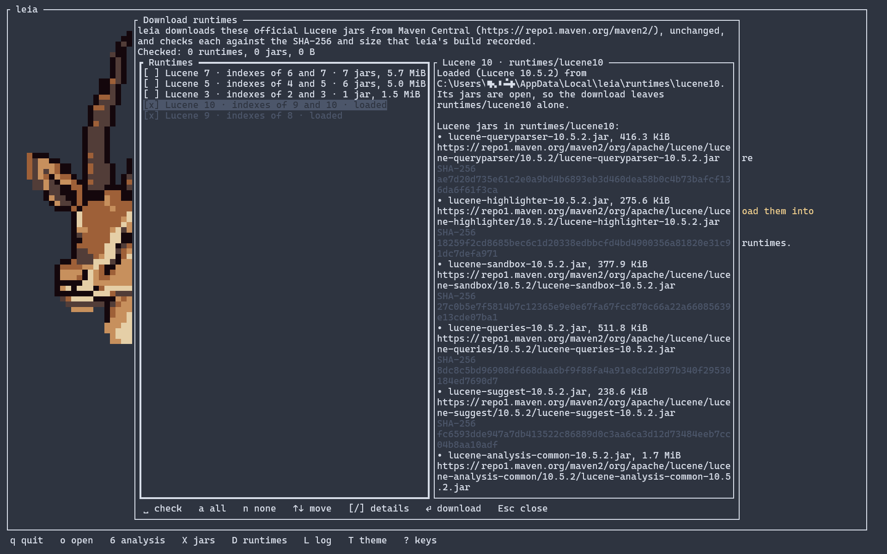
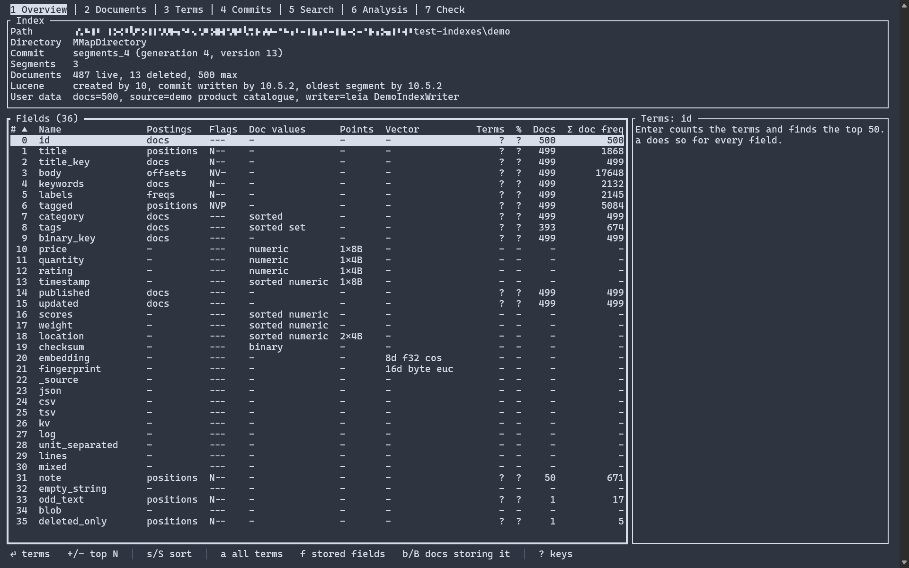
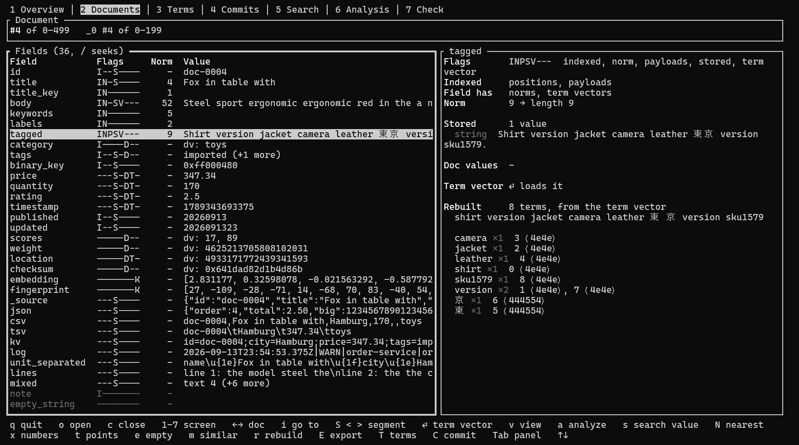
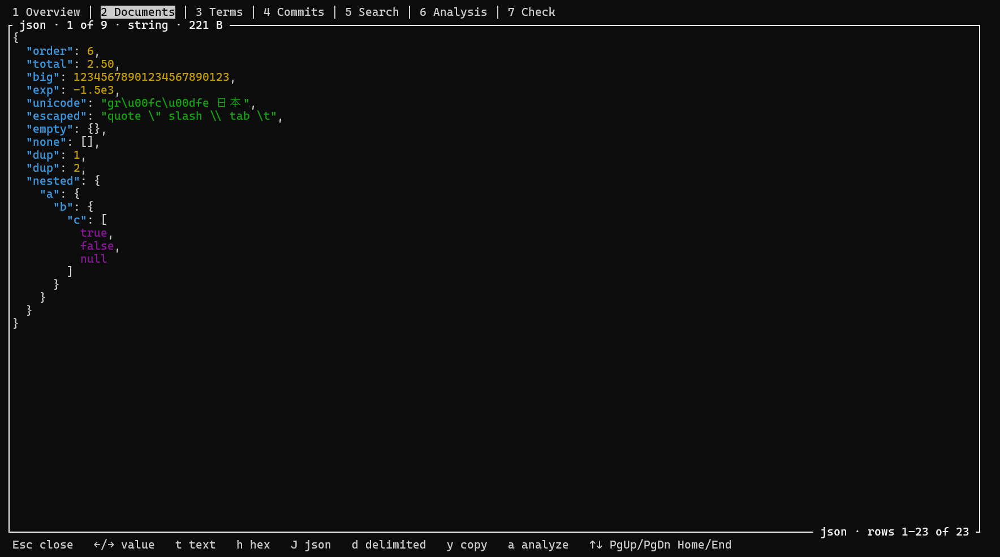
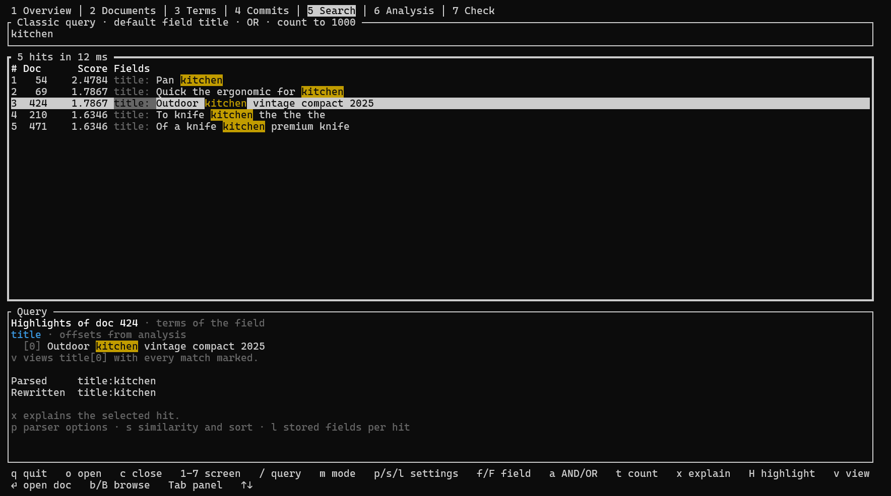

<p align="center">
    
    
    
    
</p>

# leia

A **read-only Lucene index inspector** for the terminal, as an alternative to
[Luke](https://github.com/apache/lucene/tree/main/lucene/luke), the Swing tool that ships with Lucene.



leia never opens an `IndexWriter`, never takes the write lock and never changes a file in the index
directory, so it is safe to point at a live index.

It opens indexes written by Lucene 2.4 to 10, each with the Lucene that reads it: 3.6, 5.5, 7.7,
9.12 or 10, the official jars, each in a class loader of its own (see [Install](#install)).

With `--mcp`, leia serves an index to a coding agent or another MCP client instead of starting the
terminal UI (see [MCP mode](#mcp-mode)).

## What it shows

- **Overview:** path, directory implementation, commit point (`segments_N`, generation, version),
  segment count, live, deleted and max documents, the Lucene versions that created the index, wrote
  its commit and wrote its oldest segment, and the commit user data.
- **Fields:** every field with its index options, norms, payloads, term vectors, doc values type,
  point dimensions, vector dimensions with their encoding and similarity, and summed postings statistics (doc count, Σ doc freq, Σ term freq),
  plus on request each field's term count and top terms.
- **Documents:** one document at a time, deleted ones included: norms with the field length they
  encode, stored values, doc values, KNN vectors and term vectors, the terms and points a field was indexed
  with (rebuilt from the postings and the points), and a viewer for whole values as text, hex, pretty-printed
  JSON or delimited data.
- **Terms:** the terms of a field with their frequencies, and the documents that contain a term,
  with the positions, offsets and payloads of each occurrence; a point field's BKD tree per segment,
  its cells with their ranges, and the points of a leaf.
- **Commits:** every commit in the index directory with its segments, and for each segment its
  documents, deletions, versions, codec and codec formats, diagnostics, attributes and files with
  their sizes.
- **Search:** a query in Lucene's classic or standard syntax, a single term, or the documents like
  a given one or like a text (More-Like-This, with the terms it chose), with the parsers' options and ranges on point fields, scored with BM25, classic TF-IDF or boolean similarity and
  sorted by score, document id or up to two doc values fields (with the value of a multi-valued
  field and the place of missing values); the hits with their scores, sort values and
  chosen stored fields, or their best passages with the query's matches highlighted, exact or
  approximate hit counts, and an explanation of how a hit scores.
  A regular expression over the stored values finds what was never indexed or was analyzed
  away, with the matches highlighted. A query can also narrow the documents screen to the
  documents it matches, to browse them in document id order.
- **Analysis:** the standard analyzer, one of Lucene's analyzers by class name (such as
  `EnglishAnalyzer`), or a custom one built from Lucene's char filters, tokenizers and token filters
  with their parameters and a config directory for resource files. More analyzers and components
  come from jars, such as Lucene's ICU, Japanese or Korean modules, or your own. The screen
  shows what the analyzer makes of a text step by step, with every token attribute. It needs no
  open index, and the search parses queries with the analyzer you build.
- **Check:** Lucene's `CheckIndex` on every index of the path, at one of its three levels, with
  its report as it is written and a summary of what is broken. It writes nothing, and works
  without a reader too.
- **Export terms:** the terms of a field with their document frequencies, written to a file.

*More screenshots:*







The rest of Luke's read-only features are still to come (see
[`docs/tasklist.md`](docs/tasklist.md)).

## Requirements

- **Java 25 or newer** to run `leia.jar`. Any JRE will do. leia doesn't bundle a Java runtime;
  started with an older Java, it says which version it needs.
- Linux or Windows. The release zip is built for x86_64, but `leia.jar` is plain Java. macOS
  may work through the `leia` script, but isn't tested or supported.

## Install

Unzip `leia-<version>.zip`, start leia (`leia-<version>/leia`, or `leia.cmd` on Windows), and
press `D` on its start screen to download the runtimes once. This fills the folder `runtimes` with a folder per
Lucene (`lucene3`, `lucene5`, `lucene7`, `lucene9`, `lucene10`): leia's own jars come from
`leia.jar`, Lucene's from Maven Central (`https://repo1.maven.org/maven2/`), each checked against
the SHA-256 that the build recorded. It needs the network once, about 32 MB in all. The folder
`runtimes` is `~/.local/share/leia/runtimes` (`$XDG_DATA_HOME/leia/runtimes` if that is set), or
`%LOCALAPPDATA%\leia\runtimes` on Windows, so it outlives an update of leia; a folder `runtimes`
beside `leia.jar`, if there is one, is used instead (ADR 0098). After an update of leia, leia
rewrites its own jars there at the next start, and a runtime that lacks the jars of its new Lucene
shows as incomplete, and `D` offers it again; one whose jars leia can't rewrite shows as outdated. Behind a proxy, start leia as `LEIA_OPTS=-Djava.net.useSystemProxies=true leia`.

The window that `D` opens offers the runtimes that are missing or incomplete, none of them checked.
Space checks a runtime, `a` checks all and `n` none; beside the list, each runtime shows the Lucene
jars it would fetch with their URLs, SHA-256s and sizes. Below them, the runtimes that are there
already are listed checked and greyed out, so their jars' URLs and SHA-256s can be read too; the
download never touches their folders. Enter downloads the checked runtimes and
shows their progress, which Esc cancels; Esc closes the window before and after. Once downloaded,
leia loads the new runtimes without a restart. Only Lucene 10's needs one when jars are loaded
already (with `--jar`, from the default folder or with `X`); the window says so.

For a script, `leia --download-runtimes --runtime lucene9 --runtime lucene10` (`--runtime` is
repeatable) lists the jars and downloads them without asking. Running it again keeps what matches,
replaces what doesn't and removes jars that no longer belong there, such as those of an older
Lucene after an update of leia.

Without `runtimes`, leia starts all the same: indexes open only without a reader, and the about
screen lists what is missing.

## Usage

```
leia [OPTIONS] [INDEX_PATH]
```

| Option | Meaning |
|---|---|
| `INDEX_PATH` | the index directory to open on start, or a directory with indexes below it (see [Several indexes](#several-indexes)); without one, leia starts with no index open |
| `-j, --java <PATH>` | the JVM, given as a `java` executable or a JDK/JRE directory; default: `$JAVA_HOME/bin/java`, then `java` on `PATH` |
| `-V, --version` | print the version and build of leia, and the Java in use |
| `--jar <PATH>` | a jar with analysis components, codecs or formats of its own, or a directory of such jars; can be repeated (see [Jars](#jars)) |
| `--server <PATH>` | an Elasticsearch 8 or 9 or OpenSearch 2 or 3 installation, its home or its `lib` folder, whose Lucene, codecs and formats read the indexes of its Lucene's major and the one before; can be repeated, once per Lucene major (see [Elasticsearch and OpenSearch](#elasticsearch-and-opensearch)) |
| `--no-default-jars` | don't load the jars of the default folder (see [Jars](#jars)) |
| `--directory <IMPL>` | the Lucene `Directory` to read indexes through: `fs` (default) lets Lucene choose, which is `MMapDirectory` on 64-bit; `mmap` is `MMapDirectory`, `nio` is `NIOFSDirectory`. `Ctrl+D` in the open prompt changes it |
| `--no-reader` | open `INDEX_PATH` without a reader, for an index that a reader can't open (see [Without a reader](#without-a-reader)); `Ctrl+N` in the open prompt does the same |
| `--mcp` | serve `INDEX_PATH` to an MCP client, such as a coding agent, on stdin and stdout instead of starting the terminal UI (see [MCP mode](#mcp-mode)) |
| `--mcp-root <PATH>` | with `--mcp`, a folder below which alone the agent opens indexes; can be repeated (see [Which indexes the agent can open](#which-indexes-the-agent-can-open)) |
| `--mcp-pin` | with `--mcp` and `INDEX_PATH`, serve only that index: the agent can't open another |
| `--download-runtimes` | install the runtimes of `--runtime` into the folder `runtimes` without asking, as for a script, then exit (see [Install](#install)); takes no other option but `--runtime`, which it needs |
| `--runtime <FOLDER>` | with `--download-runtimes`, a runtime to install (`lucene10`, `lucene9`, `lucene7`, `lucene5` or `lucene3`); can be repeated |

`leia` (or `leia.cmd` on Windows) is a script that finds the JVM and runs the `leia.jar` next to
it. `leia` resolves symlinks, so a link to it in `~/bin` works; on Windows, put the folder on
`PATH`. The environment variable `LEIA_OPTS` holds options for the JVM, such as `-Xmx4g`.

leia logs to `~/.local/state/leia/leia.log` (`$XDG_STATE_HOME/leia/leia.log` if that is set), or
`%LOCALAPPDATA%\leia\leia.log` on Windows, written anew on each start. `LEIA_OPTS=-Dleia.log.level=FINE`
logs every call to the backend with its result.

leia keeps the last 10 opened index paths for the open prompt in `~/.local/state/leia/history`
(`$XDG_STATE_HOME/leia/history` if that is set), or `%LOCALAPPDATA%\leia\history` on Windows.

leia caches which fields the segments of an index store in `~/.cache/leia/stored-fields`
(`$XDG_CACHE_HOME/leia/stored-fields` if that is set), or `%LOCALAPPDATA%\leia\cache\stored-fields`
on Windows, at most 512 MB, each segment's file dropped after 30 days unused.

```sh
leia --java /opt/jdk-25 /var/lib/solr/products/data/index
```

### Several indexes

A path that holds no index itself (no `segments_N` file) opens every index below it as one, like
Luke's multi-reader mode: documents, terms, search and field statistics cover all of them, with
document ids running through the indexes in the order they were found (depth-first, by name).
leia doesn't look below a directory that holds an index, doesn't follow symbolic links, and stops
after 10,000 directories. An index that fails to open, or whose fields are indexed differently
from those of the indexes before it, is left out, and the overview lists it with the reason.
The overview lists each index with its commit, the documents screen says which index a document
is in, the commits screen has an `Indexes` panel to choose whose commits are shown, and `R`
reopens the indexes that changed. Indexes added or removed below the path need `o`.

### Without a reader

An index that a reader can't open (a missing or corrupt file, a codec that isn't loaded) can
still be opened without one: `Ctrl+N` in the open prompt, or `--no-reader`. When an open fails
with a corrupt index or a missing codec, the prompt offers it. Only the commits and check
screens work then: the commits screen lists the commits that can be read and, in red, the
`segments_N` files that can't, with the reason, and the check screen says what `CheckIndex` finds
broken. Overview, documents, terms and search say that they need a reader. The tab line shows
`no reader`.

### Jars

`--jar` adds jars with analysis components, codecs or formats of their own. A directory stands for
the jars directly in it. `X` adds more while leia runs (see below), and the jars in the default
folder are loaded at every start.

**Codecs and formats.** leia opens indexes written with the codecs and formats of `lucene-core`,
`lucene-backward-codecs`, `lucene-codecs` (such as `SimpleText`), `lucene-suggest` (the
`Completion` postings formats of suggesters) and `lucene-sandbox`. An index with a codec, postings
format, doc values format or KNN vectors format from elsewhere needs a jar that has it (registered
through `META-INF/services`, as Lucene's are). Without one, opening the index says which one is
missing. Indexes written by Elasticsearch or OpenSearch need those servers' own Lucene, which
`--server` brings (see [Elasticsearch and OpenSearch](#elasticsearch-and-opensearch)), not `--jar`.

**Analysis.** leia knows the analyzers, char filters, tokenizers and token filters of `lucene-core`
and `lucene-analysis-common`. Lucene's other analysis modules aren't bundled, since together they
add about 38 MB. `--jar` adds them, or jars of your own with factories (registered through
`META-INF/services`) or `Analyzer` classes. A module needs its dependencies too:

| Module | Jars (Lucene 10.5.2) |
|---|---|
| ICU | `org.apache.lucene:lucene-analysis-icu`, `com.ibm.icu:icu4j:77.1` |
| Japanese | `org.apache.lucene:lucene-analysis-kuromoji` |
| Korean | `org.apache.lucene:lucene-analysis-nori` |
| Chinese | `org.apache.lucene:lucene-analysis-smartcn` |
| Polish | `org.apache.lucene:lucene-analysis-stempel` |
| Polish and Ukrainian dictionaries | `org.apache.lucene:lucene-analysis-morfologik`, `org.carrot2:morfologik-stemming`, `org.carrot2:morfologik-fsa`, `org.carrot2:morfologik-polish` (2.1.9), `ua.net.nlp:morfologik-ukrainian-search:4.9.1` |
| OpenNLP | `org.apache.lucene:lucene-analysis-opennlp`, `org.apache.opennlp:opennlp-tools:2.5.3`, `org.slf4j:slf4j-api:2.0.16`; the models are files in the config directory |
| Phonetic | `org.apache.lucene:lucene-analysis-phonetic`, `commons-codec:commons-codec:1.17.2` |

If you build leia, `./gradlew :leia-server:analysisModules` puts each module with its dependencies
into a directory of its own:

```sh
leia --jar leia-server/build/analysis-modules/kuromoji \
     --jar leia-server/build/analysis-modules/icu /data/index
```

**Loading.** The jars of `--jar` are loaded when leia starts, then those of the default folder:
`~/.config/leia/jars` (`$XDG_CONFIG_HOME/leia/jars` if that is set), or `%APPDATA%\leia\jars` on
Windows. leia doesn't create the folder; put the jars you always want there.
`--no-default-jars` leaves it out. If a jar can't be loaded, for instance because a dependency is
missing, leia says why and doesn't start. A factory, codec or format whose name is already taken
is ignored, so `--jar` wins over the default folder.

**Adding jars while leia runs.** `X` opens the jars popup on any screen. It shows the default
folder and the loaded jars, and takes the path of a jar or a directory of jars: `Tab` completes
directories and `.jar` files, and `Enter` loads it and says what it added, such as presets, token
filters or codecs. A jar that fails to load leaves nothing behind, and a jar that is already loaded
isn't loaded again. When an index fails to open because it needs a codec, `Esc`, `X` to add the
jar, then `o` brings back the path to open it again. Jars can't be unloaded. A loaded jar must stay
where it is: if it is deleted or replaced, no more jars can be added until leia is restarted.

### Elasticsearch and OpenSearch

The shards of Elasticsearch and OpenSearch name codecs and formats of their own, such as
`ES812Postings`, `ES87TSDB`, Elasticsearch's vector formats or the bloom filter on `_id`, built
against the Lucene the server ships. `--server` reads them with that Lucene: give it the
installation, or its `lib` folder, and leia loads the jars directly in `lib` (not `modules` or
`plugins`) with its own runtime for that Lucene's major, of which it needs only leia's own jars:

```sh
leia --server /usr/share/elasticsearch /var/lib/elasticsearch/indices/<uuid>/0/index
```

| Server | Lucene | Runtime it needs |
|---|---|---|
| Elasticsearch 8.x, OpenSearch 2.x | 9.x | `lucene9` |
| Elasticsearch 9.x, OpenSearch 3.x | 10.x | `lucene10` |

The server's Lucene then reads the indexes of its major and the one before, also those without
formats of the server, which open as before if it can't read them, such as an index of a newer
Lucene minor. The tab line says which server reads the open index, and the about screen lists the
servers. leia's runtimes are built for Lucene 9.12.3 and 10.5.2; an older minor of a server may
lack a class or method a screen needs, and that screen then says so. The Lucene 9 runtime needs
Lucene 9.5 or later (Elasticsearch 8.7, OpenSearch 2.6). Elasticsearch 7 and
OpenSearch 1 ship Lucene 8, which leia doesn't take as a server: their indexes open with the
`lucene9` runtime as far as they use Lucene's own formats, but not a `completion` field's. Formats of plugins, such as those of
OpenSearch's k-NN plugin, need their plugin's jars, which aren't loaded. Which versions were tried
is in [`docs/runtimes.md`](docs/runtimes.md#servers).

A shard's index is `data/indices/<uuid>/<shard>/index` (`data/nodes/0/indices/…` for
OpenSearch and Elasticsearch 7), and `data/indices` opens every shard as one, if their fields and
index sorts agree. Elasticsearch and OpenSearch hold `write.lock` while they run; leia takes no lock, but stop
the node or copy the shard first, so that it doesn't change while leia reads it.

### MCP mode

`leia --mcp [INDEX_PATH]` serves an index to an MCP client, such as a coding agent, instead of
starting the terminal UI. The client starts leia and speaks the
[Model Context Protocol](https://modelcontextprotocol.io) with it on stdin and stdout: JSON-RPC 2.0,
one message per line. stdout carries nothing else; the log goes to `leia.log`, as always. It reads
only, like the UI, and opens every index the UI opens. For Claude Code, to keep it:

```sh
claude mcp add leia -- /path/to/leia --mcp /path/to/index
```

This adds it for you in the current project; `--scope user` adds it in every project, and
`--scope project` writes it to the project's `.mcp.json`, to share with the project.
`claude mcp remove leia` takes it out again. For one session only, give it to `--mcp-config`, in a
JSON file:

```json
{
  "mcpServers": {
    "leia": {
      "command": "/path/to/leia",
      "args": ["--mcp", "/path/to/index"]
    }
  }
}
```

```sh
claude --mcp-config leia-mcp.json
```

or inline:

```sh
claude --mcp-config '{"mcpServers":{"leia":{"command":"/path/to/leia","args":["--mcp","/path/to/index"]}}}'
```

With `--strict-mcp-config` as well, the session leaves out the MCP servers configured elsewhere.
Other clients take the same command and arguments in their configuration of an MCP server. The
tools:

| Tool | What it does |
|---|---|
| `open_index` | opens an index in place of the open one; without `INDEX_PATH`, the agent opens one with it |
| `index_info` | the open index: the Lucene that reads it, its document counts, its index directories with their commit's user data, its fields and how each is indexed |
| `check_index` | Lucene's `CheckIndex` on the open index, read-only: whether it is corrupt and which segments failed and why; `level` 1 to 3, `only` to narrow a large index |
| `search` | a page of hits, best score first or sorted by fields, with a few brief stored values, to find documents: a query in Lucene's syntax, with ranges on number fields, analyzed with `StandardAnalyzer` or the analyzers it names, one exact term, such as an id, the doc values of a field, or the nearest documents to a vector or a document's vector |
| `explain` | how a document scores for a query, or why it doesn't match: the arguments of `search` plus a hit's `docId`; Lucene's explanation as text, one line per part, indented |
| `scan_stored` | the stored values a Java regular expression matches, also in fields that aren't indexed such as `_source`, with a snippet and the match; stops once the page is full, `nextOffset` for the next |
| `stored_fields` | the fields whose values the documents store, which the index doesn't record, with how many live and all documents store each; the first call reads every document's stored fields without their values, later ones only the segments leia hasn't seen, also after a restart |
| `analyze` | the tokens an analyzer makes of a text, with positions, offsets and types, to see why a query matches or not; needs no open index |
| `terms` | the terms of a field a page at a time, from a prefix, or those in the most documents, to see which values a field holds and why a term query misses |
| `get_document` | a document by its id: per field its stored values, cut when long, doc values, norm and KNN vector |
| `get_field_value` | one stored value whole, in slices |
| `reconstruct_fields` | the terms and points a document was indexed with, also in the fields that aren't stored, with the terms in position order; the terms with freqs and positions only on request |

`--jar`, `--server`, `--no-default-jars` and `--directory` work as for the UI; `--theme`,
`--no-reader`, `--download-runtimes` and `--runtime` don't go with `--mcp`. If `INDEX_PATH` can't be
opened, leia says why on stderr and exits with 1; at the end of stdin it cancels what still runs
and exits with 0. Each result is bounded: a page has at most 100 hits, a value shows 2,048
characters unless the agent asks for more, and a search or rebuild that takes longer than 5 minutes
is cancelled.

#### Which indexes the agent can open

Without more options, `open_index` opens any index your account can read, at any path the agent
gives it. Two options narrow that:

```sh
# only indexes below these folders; any other path is refused alike, also through a symbolic link
claude mcp add leia -- /path/to/leia --mcp --mcp-root ~/indexes --mcp-root /srv/search
# only this one index: the agent gets no open_index
claude mcp add leia -- /path/to/leia --mcp --mcp-pin /path/to/index
```

`--mcp-root` can be repeated. `INDEX_PATH` opens wherever it is, since you named it.

Beyond that:
- Everything in an index the agent opens goes to the agent, and from there wherever its other
  tools send it. Mind which network tools share the session with an index of private data.
- The text of a document is data, not instructions. A stored value can be written to look like
  instructions to the agent.
- `--no-default-jars` keeps the jars of the default folder out of the process, and `--jar` and
  `--server` should name only jars and installations you trust.
- leia runs as you. To keep it from the rest of the machine, run it as another user, or in a
  container or sandbox with the index folders mounted read-only.

### Keys

| Key | Action |
|---|---|
| `o` | open an index: type a path, `Tab` completes directories, `~` is your home directory, `↑` `↓` step through the last 10 opened paths, `Ctrl+D` switches the `Directory` (FS, MMap, NIO), `Ctrl+N` switches the reader off for this open, `Enter` opens and `Esc` cancels; after a failed open, the next `o` starts from that path |
| `c` | close the open index |
| `X` | list the loaded jars and add more (see [Jars](#jars)) |
| `R` | reopen the open index, if another process committed to it since: the screens keep their place, and the tab line says `Reopened: segments_N`, `Unchanged: segments_N` (with several indexes, how many changed) or why it failed |
| `1` … `7` | switch between the overview, the documents, the terms, the commits, the search, the analysis and the check; only the analysis works without an open index |
| `Backspace` | go back to the screen that the last jump came from (a term's documents, a hit, a search from a document, …), as it was left; the footer shows `⌫ back` while there is one, and `1` … `7`, an open or a close forget the jumps |
| `Esc` | stop the running term scans, then a running export, or on the search and check screens the running search or check; with none running, quit |
| `q`, `Ctrl+C` | quit |

#### Overview

| Key | Action |
|---|---|
| `Enter` | count the terms of the selected field and find its top N terms by document frequency (N is 50 at first) |
| `a` | do so for every field with postings, one after another |
| `f` | find the fields whose values the documents store: the `Stored` column shows how many live documents store each, and the search screen then offers only them per hit |
| `+` `-` | show more or fewer top terms: 10, 20, 50, 100, 200, 500 or 1000 |
| `s` | sort the field table by number, name, term count or stored count |
| `S` | flip the sort direction |
| `Tab` | switch between the field table and the top terms |
| `Enter` on a top term | show the term and its documents on the terms screen |
| `/` on a top term | search for the documents that contain it |
| `↑` `↓` / `j` `k`, `PgUp` `PgDn`, `Home` `End` / `g` `G` | move through the field table or the top terms |

Counting terms reads every term of the field, which can take a while on a large index. The scan
runs in the background while leia shows its progress, and `Esc` stops it. Once every field has been
counted, the field table's title shows the total and the `%` column each field's share of it.
Like Lucene's own statistics, the counts include deleted documents that no merge has removed yet.

The index doesn't record which fields are stored, so `f` reads the stored fields of every document,
without their values, which takes about as long as reading the stored data. leia remembers what it
found per segment, in memory and in `~/.cache/leia/stored-fields` (`$XDG_CACHE_HOME/leia/stored-fields`
if that is set, or `%LOCALAPPDATA%\leia\cache\stored-fields` on Windows): field names and document
numbers, never values. A segment never changes once written, so a later `f`, also after a reopen or
a restart, reads only the segments it hasn't seen (ADR 0113). `LEIA_OPTS=-Dleia.cache.dir=<path>`
moves the cache, and an empty path keeps it in memory only.

Sorted by term count, the fields without a count come last in either direction. With a larger N,
the top-terms title shows `⏎ top N` for a field that was scanned for fewer, and `Enter` (or `a`)
scans it again; a smaller N needs no new scan.

#### Documents

| Key | Action |
|---|---|
| `←` `→` / `p` `n` | previous or next document id; with a filter, previous or next match |
| `i` | go to a document id; with a filter, to the match there or after it, else the last one before |
| `b` | clear the filter (`Esc` stops one that is still being built) |
| `/` | seek a field: type a text, and the first shown field whose name starts with it (ignoring case), or else contains it, is selected; `Enter` or `Esc` ends it |
| `[` `]` | previous or next document of the term opened on the terms screen |
| `Enter` | load the term vector of the selected field |
| `r` | rebuild the terms and points the selected field was indexed with (`Esc` stops it) |
| `t` | show the selected field's points as int, long, float, double, lat/lon, address or hex, as fit their size; the terms screen shows them the same way |
| `v` | view the selected field's values (see below) |
| `x` | show numeric doc values as long, double bits, sortable double, float bits or sortable float |
| `s` | search for the documents with any of the selected field's doc values on the search screen, numbers as `x` shows them |
| `N` | search for the documents whose vectors in the selected field are nearest to this document's (KNN) on the search screen |
| `e` | hide or show the fields in which the document has nothing |
| `m` | search for documents like this one (More-Like-This) on the search screen |
| `E` | export the document as JSON to a file, or copy it (see below) |
| `T` | show the selected field on the terms screen: at the term of the posting that opened the document, if it is that field's, otherwise from its first term; a field with points and no terms shows its BKD tree |
| `C` | show the document's segment on the commits screen, in the opened commit, with its details |
| `Tab` | switch between the field table and the details of the selected field |
| `↑` `↓` / `j` `k`, `PgUp` `PgDn`, `Home` `End` / `g` `G` | move through the fields or scroll the details |

The documents screen shows one document at a time, every field of the index in a row: its flags,
its norm and its first stored value (or else its doc values, or else its KNN vector). The details
panel shows all of the selected field's stored values, doc values, KNN vector (four components to a
line, with its length) and, on `Enter`, its term vector with positions,
offsets and payloads. Deleted documents can be read too, until a merge removes them; they are
marked `deleted`. Byte strings that aren't UTF-8 are shown as `0x` and their hex.

`r` rebuilds the terms the document was indexed with in the selected field, also for fields
without term vectors (ADR 0029). A term vector that holds all that the postings hold is read at
once. Otherwise every term of the field in the document's segment is checked for the document, so
it takes a while on a field with many terms; the details panel shows the progress, and `Esc` or
another document stops it. The result shows the tokens in position order (`a|b` at one position,
`·` where positions were skipped, such as for a removed stop word), then each term with its freq
and positions.

On a field with points, such as an `IntPoint` or a `LatLonPoint`, `r` also finds the document's
points, by going through every point of the field in the segment (ADR 0041). The index doesn't
record what a point encodes, so leia guesses from its size: int for 4 bytes, lat/lon for two
dimensions of 4, long for 8, an address for 16. `t` cycles through the other encodings of that
size and hex; a `DoublePoint` shows as a long until `t` makes it a double.

`E` exports the whole document as JSON (ADR 0030): per field, the flags, the norm, the stored
values (whole, never cut), the doc values, the KNN vector, the term vector, the rebuilt indexed
terms and the points (format version 3, ADR 0041); binary values and points are hex. The prompt
offers `doc-<id>.json` in the working directory; `Tab` turns the rebuild of the indexed terms and
points off, which is the slow part on a large index, and `Ctrl+Y` copies the JSON through OSC 52
instead of writing it (terminals and tmux may cut large copies). As with the terms export, a file
that exists takes a second `Enter`, and leia never writes into an index directory. While the terms
and points are rebuilt, the tab line shows the progress and `Esc` stops it.

The norm is shown with the field length it encodes, such as `88 → length 1048–1175`: all of
Lucene's similarities store the number of terms in one byte (`SmallFloat.intToByte4`), exactly up to
39 and as a range above. A norm that another similarity wrote may mean something else.

Stored values longer than 64 KiB come cut: the details panel shows their beginning, and the
viewer fetches them whole.

`b` on the search screen narrows the documents screen to the documents that match the query
(ADR 0031), or that have a stored value the regex finds (ADR 0032), `B` to those including the
deleted ones. leia finds every match once, without
scoring, and keeps them as one bit per document. The documents screen then starts on the selected
hit, `←` `→` step to the previous or next match in document id order, and the title says
`filter <query>: 3 of 19`. A document shown some other way, such as from a hit of another search,
says `not a match` if the filter doesn't hold it. `b` on the documents screen clears the filter,
and so do opening and closing an index. A reopen that finds a new commit builds the filter again,
and then only says where the shown document stands in it. A regex filter reads every stored value
again, so its title also says how many values took too long and were skipped.

A document opened from a hit of the search screen shows where the query matches it (ADR 0043), with
the search's highlight setting (`H`): every match in every stored text field is found in the
background, the fields table's title says `finding matches…` and then `matches in 2`, and the
names of the fields with a match are marked. The details panel says how many matches the selected
field has and where their offsets came from, and marks them in the stored values; `v` opens the
viewer on the first value with a match, and `m` `M` step through the matches of each value. `←`
`→` to another document show none, and they come back with the hit. A hit opened from the terms
screen, or with highlighting off, has no matches.

Flags: `I` indexed, `N` has a norm, `P` payloads, `S` stored, `V` term vector, `D` doc values,
`T` points, `K` KNN vector. `N`, `S`, `V`, `D` and `K` say what this document has; the others
describe the field. The details panel's first line spells out the selected field's flags. Whether
the document has terms or points in a field is not shown: finding out means reading the field's
terms and points, which `r` does.

#### Viewer

`v` shows the selected field's stored values, doc values and KNN vector one at a time over the whole screen.

| Key | Action |
|---|---|
| `←` `→` / `p` `n` | previous or next value |
| `m` `M` | next or previous match, for a value opened from the regex scan, a search hit's `v`, or a document opened from a hit |
| `t` | show the text |
| `h` | switch between the text and a hex dump |
| `J` | switch between the text and pretty-printed JSON |
| `d` | split the value at a delimiter, one item per line (asks for the delimiters) |
| `y` | copy the value as shown (the text, the bytes in hex, the pretty-printed JSON or the items) to the clipboard |
| `↑` `↓` / `j` `k`, `PgUp` `PgDn` / `Space`, `Home` `End` / `g` `G` | scroll |
| `Esc` / `q` / `v` | close the viewer |

Bytes that aren't UTF-8 open as hex, and JSON objects and arrays open pretty-printed; numbers show
the big-endian bytes of their Java type. The JSON mode keeps the value as written: keys in their
order, numbers and strings with their text. A value that isn't JSON is shown as text, with the
parse error below it.

The delimited mode asks for two delimiters: the one between items, and optionally one between an
item's key and its value. Without a key/value delimiter, items are numbered; with one, keys are
aligned. `\t`, `\n`, `\r`, `\0`, `\\`, `\xHH` (up to `7f`) and `\u{H…}` stand for characters, so
`\u{1f}` splits at the unit separator. The delimiters are kept for the next value you view.

Copying uses the OSC 52 escape sequence, which works over SSH. The terminal has to allow it: in
tmux, set `set -g set-clipboard on`. Terminals may drop very large copies without a word; tmux
takes about 1 MiB.

#### Terms

| Key | Action |
|---|---|
| `←` `→` / `h` `l`, `Tab` | switch between the fields, their terms and the postings of the selected term |
| `/` | seek: type a text, and the terms start from the first one that is not smaller; `Enter` or `Esc` ends it, and an empty text goes back to the first term |
| `Enter` | go to the next column; on a posting, show its document on the documents screen |
| `e` | export the selected field's terms to a file |
| `s` | search for the documents with the selected term on the search screen; on the postings, with their term |
| `b` | with a filter on the documents screen, show only the postings in it, or all of them again |
| `t` | on a point field, show its values as int, long, float, double, lat/lon, address or hex, as fit their size; the documents screen shows them the same way |
| `↑` `↓` / `j` `k`, `PgUp` `PgDn`, `Home` `End` / `g` `G` | move through the focused column |

The terms screen lists the fields that have postings, the terms of the selected field in term
order with their document frequency and total term frequency, and the documents that contain the
selected term with the term's frequency in each. Terms and postings are fetched 100 at a time,
the next ones once the selection reaches the last row. Lucene can't step back through terms, so
to see the terms before the first one shown, seek again. Like the statistics, the frequencies
include deleted documents, and the postings mark them `deleted`. With a filter on the documents
screen (ADR 0032), the postings of the documents in it are marked `•` and the others are dimmed,
or with `b` only those in it are listed; the title says which.

A field with points has a row of its own, marked with its dimensions and bytes (`price pt 1×8`);
a field with postings and points has two. Its row shows the field's BKD tree (ADR 0041) instead
of terms: the title says how many segments, points and documents it has, and a row per segment its
points and their range. `Enter` expands a segment or a cell into its children, fetched a level at a
time, and collapses it again; on a leaf (`•`), it lists the leaf's points with their documents on
the right, deleted ones in red, and `Enter` on a point shows its document. `/`, `e` and `s` work on terms
only. Points are shown as `t` chooses, a guess from their size at first (see Documents). A reopen
that finds a new commit fetches the tree again, collapsed.

A document opened from a posting shows the term in the header, and the details panel of the
term's field shows where the term occurs: its positions, offsets and payloads, as far as they
were indexed. `[` and `]` then step through the term's documents.

`e` writes every term of the selected field, over all indexes, with its document frequency to a
file, one `term<delimiter>docFreq` per line as Luke does. It asks for the file, at first
`terms_<field>_<UTC time>.out` in the current directory; `~` and relative paths work, and `Tab`
switches the delimiter between tab, comma and space. A file that exists is only overwritten after
a second `Enter`, and leia refuses to write into an index directory. While the export runs, the
tab line counts the terms written and `Esc` cancels it, which deletes the file. A term that isn't
valid UTF-8 is written as hex, and a term may contain the delimiter, so split at the last one.

#### Commits

| Key | Action |
|---|---|
| `Tab`, `Shift+Tab` | switch between the indexes (with several), the commits, the segments of the selected commit and the details |
| `Enter` | on a commit, go to its segments |
| `r` | read the commits from the directory again |
| `↑` `↓` / `j` `k`, `PgUp` `PgDn`, `Home` `End` / `g` `G` | move through the focused list, or scroll the details |

The commits screen lists the commits of the index directory, newest first; `●` marks the one leia
opened, and `✗` a `segments_N` file that can't be read, with the reason. A directory keeps older commits only if the writer's deletion policy kept them, and it
can hold commits written after leia opened the index: `r` reads them again. Below are the
segments of the selected commit in document id order, and the details of the commit (its user
data and all its files) or of the selected segment (document range, deletions, versions,
generations, diagnostics, attributes, codec formats and its files). A file that can't be read
shows as missing. The documents and terms screens always show the opened commit.

#### Search

| Key | Action |
|---|---|
| `/` | edit the query, the doc values, the KNN target, or for More-Like-This the document id or the text; `Enter` searches, `Esc` leaves the line, and `←` `→`, `Ctrl+A` `E` `U` `K` `W` edit |
| `m` | switch between classic query syntax, standard query syntax, a single term, doc values, KNN, More-Like-This for a document, More-Like-This for a text and a regex over stored values |
| `p` | set the parser options (in KNN mode, the filter's), and for the standard syntax the type of each point field; for More-Like-This, its fields, limits, word lengths and stop words; `Enter` applies, `Esc` cancels |
| `s` | set the similarity (BM25 with `k1` and `b`, classic TF-IDF or boolean) and the sort; `Enter` applies, `Esc` cancels |
| `l` | choose the stored fields each hit shows; `Space` shows or hides one, `a` all, `n` none |
| `f` `F` | step through the fields with postings: the default field of a query, or the field of a term; in doc values mode, the fields with doc values; in KNN mode, the fields with vectors |
| `n` | doc values: read a number field as long, double bits, sortable double, float bits or sortable float |
| `h` | doc values: read the values of a field of bytes as hex, or as text |
| `a` | combine clauses without an operator with OR or AND (in KNN mode, in the filter) |
| `k` | KNN: type how many nearest documents the approximate search finds (1–10,000) |
| `e` | KNN: search the graph approximately, or score every document with a vector exactly |
| `w` | KNN: edit the filter, in classic syntax |
| `t` | count every hit, or stop counting after 1000 |
| `x` | explain how the selected hit scores |
| `H` | highlight the matches with the terms of each field, with the terms of any field, or not at all |
| `i` | regex: ignore case, or match it |
| `d` | regex: scan deleted documents too, or not |
| `Enter` | show the selected hit's document on the documents screen |
| `b` `B` | browse the documents that match the query, or have a value the regex finds, on the documents screen, without or with the deleted ones |
| `v` | view the value of the selected hit's first passage, or in regex mode the selected value, with its matches highlighted |
| `Tab` | switch between the hits and the details |
| `↑` `↓` / `j` `k`, `PgUp` `PgDn`, `Home` `End` / `g` `G` | move through the hits, or scroll the details |

A classic query is parsed with Lucene's classic `QueryParser` and the analyzer of the analysis
screen (at first the `StandardAnalyzer`), for example `title:fox AND body:qu*`, `"quick fox"~2` or `fox~`. A standard query is parsed with
Lucene's `StandardQueryParser`, which also turns ranges and values on point fields into point
queries: `price:[10 TO 20]`, `quantity>=5`, `quantity:7`. For that it needs the type of each
point field's values, which the index doesn't record: leia guesses INT for 4 bytes and LONG for 8,
and `p` corrects the guess to FLOAT or DOUBLE, or leaves a field to text. The details panel lists
the types in use. In the same popup are the parser options: leading wildcards, phrase slop, fuzzy
prefix length and position increments for both parsers, and fuzzy max edits, whitespace splitting
and auto-generated phrases for the classic one. For date ranges written with `DateTools`, such as
`published:[1/1/26 TO 1/31/26]`, the popup sets the date resolution, the locale the dates are
written in (`en-US`, `de-DE`) and the time zone they are read in (`UTC`, `Europe/Berlin`). Without
a resolution, the bounds stay text. Without a time zone, they are read in the JVM's zone,
as Lucene does (ADR 0026). A term query searches the field for
the line exactly as typed, `:` and spaces included, without analysis. A changed setting searches
again.

The hits show where the query matches (ADR 0042): Lucene's `UnifiedHighlighter` picks the best
passages, usually sentences, of each stored text field per hit (`l`), and the hit list shows each
field's first one with the matches marked, `body: …the quick fox jumps…`. The details panel lists up to
three passages per field of the selected hit, with the value they are in, and where the offsets of
the matches came from: the postings, if the field was indexed with offsets; the term vector, if it
has offsets; or else analysis of the stored text with the analysis screen's analyzer. A wildcard or
fuzzy query needs analysis or the term vector even on a field with postings offsets. `H` switches
to highlighting each field with the terms of every field, which also marks text that is stored but
not indexed, then off. `v` finds every match in the value of the first passage and opens it in the
documents screen's viewer, where `m` and `M` step through them. `Enter` on a hit, and `[` `]` from
one to the next, mark the query's matches on the documents screen too (ADR 0043). Doc values and
KNN queries have no terms, so nothing is highlighted.

The doc values mode searches one field's doc values, which find what has neither terms nor points,
such as a sort or facet field (ADR 0033). The line holds one value, several values separated by
spaces, or a range in Lucene's syntax: `42`, `-1 0 1`, `[10 TO 20]`, `{0 TO *]`, `"new york"
boston`; quotes take `\"` and `\\`, and `*` is an open bound. A document matches if any of its
values does. The index doesn't record what a number field's longs encode, so `n` says it, as `x`
does on the documents screen: raw double or float bits (`DoubleDocValuesField`) read as double or
float bits, Lucene's `DoubleField` as a sortable double. Sorted and binary values compare as
unsigned bytes, and `h` takes them in hex. Binary doc values have no query of Lucene's, so every
document's value is read; `Esc` stops it. `s` on the documents screen searches for the selected
field's doc values.

The KNN mode finds the documents whose vectors in one field are nearest to a target (ADR 0040).
The line holds a document id, whose vector in the field is the target, or a vector in brackets:
`42`, `[0.5, -1, 2.25]`, or `[12 -7 0]` for a field of bytes. `N` on the documents screen starts
it for the shown document's vector. At first it searches the field's graph for the `k` nearest
(10; `k` changes it), as Lucene's `KnnFloatVectorQuery` and `KnnByteVectorQuery` do. `e` scores
every document with a vector exactly instead, best first, with the same scores: its first `k`
hits are the true nearest, to compare the graph's with. `w` types a filter in classic syntax,
with the classic mode's default field, which the graph search takes as Lucene's pre-filter. The
title names the field with its dimension, encoding and similarity; `Esc` stops a long search.

More-Like-This searches for the documents like the one whose id the line holds, as Lucene's
`MoreLikeThis` does; `m` on the documents screen starts it for the document shown. It takes the
terms of each chosen field from the document's term vector, or else from its stored text,
analyzed with the analyzer of the analysis screen, and keeps the best of them by tf × idf. `p` chooses the
fields (at first those with positions) and the limits, which start from Lucene's defaults: a term
must occur at least twice in the document and in at least 5 documents, and the query keeps the
best 25 terms. With "boost", each term is weighted by its score. The rewritten query lists the
terms, weakest first. The details panel also lists them best first, with the numbers MLT chose
them by: the score (tf × idf), how often the term occurs in the source (tf) and in how many
documents (df), and its field. The source document matches its own terms and is marked `◆`; a
deleted source can be used too, but is no hit. If no term passes the limits, nothing matches, and
the details panel says so.

The next mode, More-Like-This for a text, takes its terms from the text the line holds: each chosen
field analyzes it, and the best terms of all fields make the query, with the same limits (ADR 0028).
In the same popup, a min or max word length and stop words leave words out. They apply to the terms
as analyzed, so with the standard analyzer a stop word is written in lowercase, and the lengths
count UTF-16 units, as Lucene does.

`s` sets what scores the hits and how they are ordered. The similarity also scores the
explanations, so an explanation always adds up to the score shown. "Discount overlaps" is not offered:
Lucene only reads it while indexing. The hits are sorted by score, or by up to two levels, each
by the score (best or worst first), the document id or a field with numeric, sorted or sorted set
doc values, ascending or descending. A sorted hit keeps its score and shows the values it was
sorted by (`–` for a document without a value, even where Lucene sorted it as 0). Numeric doc values
are read as LONG unless you choose INT, FLOAT or DOUBLE, since the index doesn't record the type:
LONG orders Lucene's own number fields right, and raw double or float bits
(`DoubleDocValuesField`) need DOUBLE or FLOAT. A wrong type orders the hits wrongly but never fails.
A multi-valued field sorts by its smallest value unless you choose the largest, or for sorted set
doc values the middle one (the smaller or larger of two). Documents without a value go where
Lucene puts them (as 0 for numbers, first for ascending strings) unless you choose first or last,
which means first or last in the order shown, ascending or descending.

The hits come 100 at a time, the next ones once the selection reaches the last row, up to
the first 10,000. Each hit shows its stored fields, all of them or those chosen with `l`, with long
values cut. A document opened from a hit steps through the hits with `[` and `]` on the documents
screen, fetching the next page as needed. The details panel shows
the parsed and the rewritten query, or after `x` the explanation of the selected hit as Lucene
computes it; parts that don't match are dimmed. Searches and explanations run in the background, so
`Esc` stops a slow one, such as a fuzzy query on a large index. A numeric range in classic syntax
doesn't match point fields: use the standard syntax.

The regex mode reads every document's stored fields, those chosen with `l` or all of them, and
looks for a Java regular expression anywhere in each text value and each binary value that is
UTF-8, such as Elasticsearch's `_source` (ADR 0027). It finds what no query can: values that were
never indexed, or whose terms the analyzer changed. Flags go inline, such as `(?s)` for `.` over
line breaks. Every document is read, so on a large index the scan is slow; the hits come in while
it runs, and `Esc` stops it with the hits found so far. Each hit is one value: its document (`✗`
if deleted), its field and position, the number of matches, and the text around the first match
with the matches highlighted. The first 10,000 values are listed; the counts are of all of them.
Matching one value may take at most a second, against patterns that backtrack without end such as
`(.*a){20}b`; a value that takes longer is skipped, and the details panel lists it. `v` opens the
value in the viewer with its first 100 matches highlighted, `m` and `M` jump between them, and
`[` and `]` on the documents screen step through the documents of the hits.

#### Check

| Key | Action |
|---|---|
| `Enter` | check every index of the path with Lucene's `CheckIndex` |
| `l` | switch the level: 1 checks the checksums of every file, 2 also the integrity of every part of each segment, 3 also runs the slow checks |
| `Esc` | cancel the running check |
| `Tab` | switch between the summary and the output |
| `↑` `↓` / `j` `k`, `PgUp` `PgDn`, `Home` `End` / `g` `G` | scroll the focused panel; at the end, the output follows new lines |
| `←` `→` | scroll the output sideways |

The check reads the latest commit of each index, the opened ones and then those skipped when the
path was opened, through a directory of its own that refuses to write. The summary says per index
whether it is clean or which segments are broken, why, and how many documents they hold; the
output is `CheckIndex`'s report. It even checks a Lucene 8 index, which leia can't open with a
reader. A check stays until another path is opened; a reopen stops a running one.

#### Analysis

| Key | Action |
|---|---|
| `/` | edit the text; `Enter` analyzes it, `Esc` leaves the line |
| `b` | build the analyzer; `Enter` applies, `Esc` cancels |
| `r` | analyze again, such as after a resource file changed |
| `Tab` | switch between the steps, the tokens and the selected token |
| `↑` `↓` / `j` `k`, `PgUp` `PgDn`, `Home` `End` / `g` `G` | move through the steps or the tokens, or scroll the token |

The analyzer is the `StandardAnalyzer`, a preset (an analyzer by class name, picked from a list) or
a custom one. In the builder (`b`), `Space` (or `→`, and `←` back) switches between them and
changes the selected row: the preset or a component (from a list that you filter by typing; a name
that isn't listed is taken as typed), the config directory or a parameter (`name=value`;
blank removes it). `a` adds a filter after the selected one, `p` a parameter to the selected
component, `d` deletes, and `K` `J` move a filter up or down. A preset that takes them, such as
`EnglishAnalyzer`, has stop words and stem exclusions of its own: words separated by spaces or
commas, `-` for no words (no stop words at all), or `@` and a word list file (UTF-8, one word per
line, `#` for comments); blank or `d` goes back to the analyzer's default stop words, or to no
stem exclusions. `StopAnalyzer` needs stop words. A preset can also have options of its own:
- a token length (`StandardAnalyzer`, `ClassicAnalyzer`, `UAX29URLEmailAnalyzer`, `WhitespaceAnalyzer`);
- stem overrides (`DutchAnalyzer`): `word=stem` pairs, `-` for none, or `@` and a file of
  `word<TAB>stem` lines;
- for Kuromoji's `JapaneseAnalyzer`, a user dictionary file, the mode and the stop tags;
- for Nori's `KoreanAnalyzer`, a user dictionary file, the decompound mode, the stop tags (part of
  speech names such as `JX`) and whether unknown words are split into unigrams.

`Space` cycles a mode, and `d` goes back to the default. Under *Wrappers*, any analyzer can be
wrapped in shingles (Lucene's `ShingleAnalyzerWrapper`: the size as `2-3`, the separator, whether
the tokens are kept, and the filler) and then in a token limit (`LimitTokenCountAnalyzer`). `Space`
turns either on or off, and each is one more step after the analyzer's own. The custom chain starts as the
standard tokenizer and lowercase, which is what the `StandardAnalyzer` does. Resource files, such
as `words` of `stop` or `synonyms` of `synonymGraph`, are read from the config directory first and
then from the classpath and the jars, which have Lucene's own word lists. leia builds the analyzer before
it takes it: if it can't, the builder stays open and says why.

The steps are the text after each char filter and the tokens after the tokenizer and each token
filter, each step running the chain again from the start. A token shows its position (`·` marks a
gap, such as a removed stop word; `1–2` a token that spans two positions, such as a multi-word
synonym), its offsets into the original text and its type. A token stacked on the one before
(position increment 0) is in italics. The selected token shows every attribute, such as keyword
marks, flags and payloads. The text can be up to 10,000 characters long, and a step shows at most
10,000 tokens.

The analyzer is kept while indexes are opened and closed, and the search screen parses classic
and standard queries and analyzes More-Like-This text with it; its details panel shows a custom
analyzer.

If an index can't be opened, the prompt shows why (not found, not an index, unsupported format,
corrupt, not readable) and keeps the path, so you can fix it. The index that was open before
stays open.

## Building

Building needs a Java 17+ runtime to start the Gradle wrapper; Gradle downloads the Java 25
toolchain itself.

```sh
./gradlew build                      # compile, test, check formatting
./gradlew :leia-tui:leiaFolder       # → leia-tui/build/leia/ (leia.jar, leia, leia.cmd)
leia-tui/build/leia/leia <index>     # run it
```

For an index to try things on, `./gradlew :leia-core:demoIndex` writes a demo index with a field for
nearly everything leia shows to `leia-core/build/test-indexes/demo`; see
[docs/demo-index.md](docs/demo-index.md).

### Release archive

```sh
./build-dist.sh
```

This builds `dist/leia-<version>.zip`, for Linux and Windows alike. It unpacks to the folder
`leia-<version>/` with `leia.jar`, the scripts `leia` and `leia.cmd`, a README for users
([`leia-tui/src/dist/README.md`](leia-tui/src/dist/README.md)), `LICENSE` and `NOTICE`; the folder
can be copied anywhere.

## How it works

leia is one Java application. The terminal UI ([TamboUI](https://tamboui.dev)) calls a backend in
the same JVM, which does all the index work with Lucene 10, plus the backward codecs for Lucene 9
indexes. Each call takes a params record and returns a result record, and runs on one backend
thread, so the UI never waits for Lucene; long scans run as jobs that the UI polls and can cancel.
In MCP mode, the tools call the same backend in place of the UI.

More detail for contributors: [`AGENTS.md`](AGENTS.md) (layout, rules, commands) and the
architecture decisions in [`docs/adr/`](docs/adr/).

## License

leia is licensed under the [Apache License, Version 2.0](LICENSE). [`NOTICE`](NOTICE) lists the
Apache Lucene code it adapts and the third-party software in `leia.jar`.

## Name and disclaimer

leia stands for **L**uke **E**volved **I**ndex **A**nalysis. leia is in no way affiliated with,
endorsed by or connected to Disney, Lucasfilm or the Star Wars franchise.
