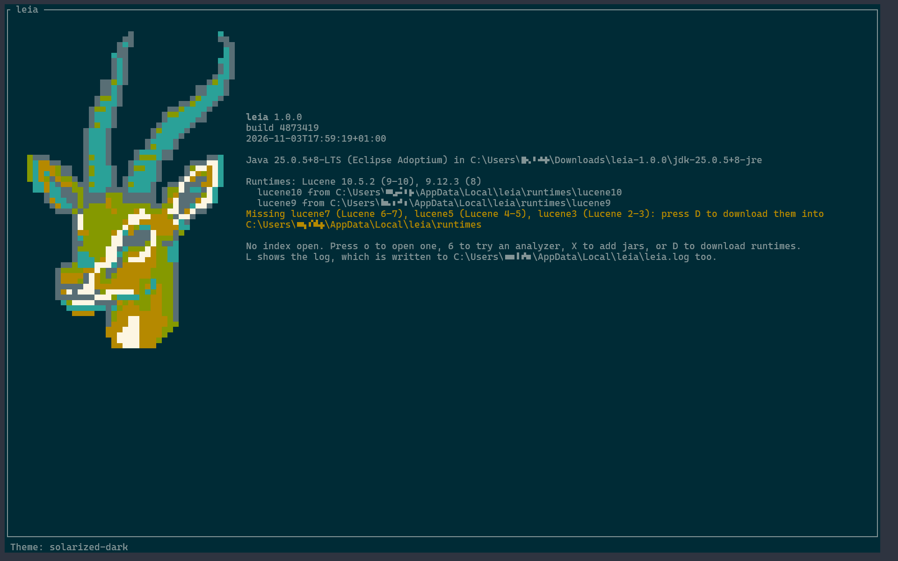
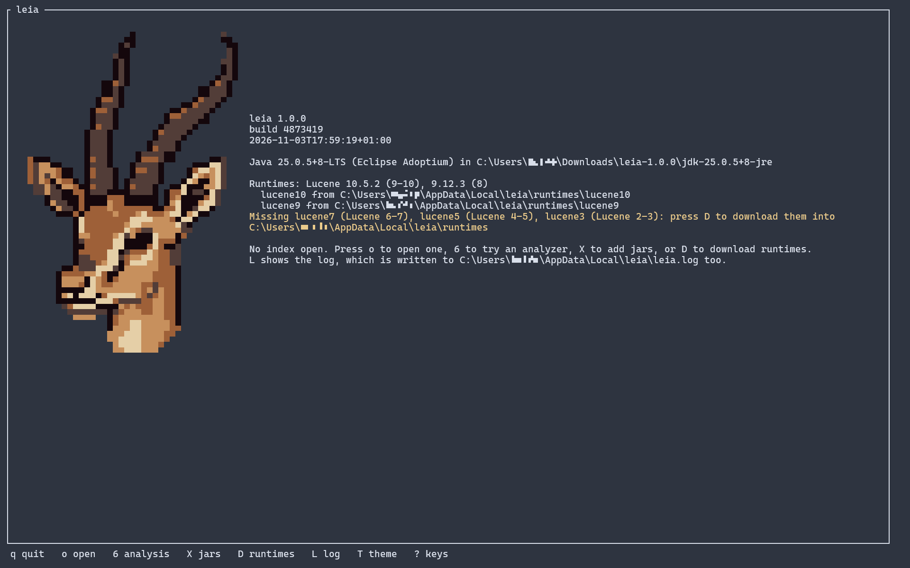
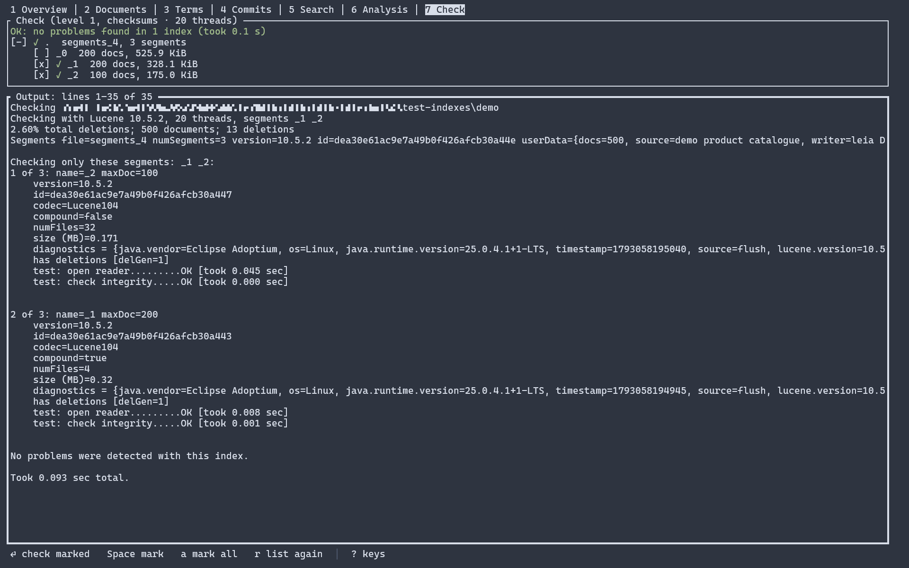

<p align="center">
    
    
    
    
</p>

# leia

A **read-only Lucene index inspector** for the terminal, as an alternative to
[Luke](https://github.com/apache/lucene/tree/main/lucene/luke), the tool that ships with Lucene.


- **Read-only:** never opens an `IndexWriter`, never takes the write lock, never changes a file in
  the index directory. Safe to point at a live index.
- **Lucene 2.1 to 10:** each index is read by the Lucene that can read it, the official jars, each
  in a class loader of its own (see [Runtimes](#runtimes)).
- **MCP server:** with `--mcp`, leia serves an index to a coding agent instead of starting the UI
  (see [MCP mode](#mcp-mode)).
- **Sorting** of field names (😉 sorry, luke)

## What it shows

- **Overview:** commit, segments, document counts, the Lucene versions that wrote the index, user data.
- **Fields:** index options, norms, payloads, term vectors, doc values, points, vectors, postings
  statistics; on request each field's term count and top terms.
- **Documents:** one at a time, deleted ones included: stored values, norms, doc values, vectors,
  term vectors, and the terms and points a field was indexed with; a viewer for text, hex, JSON or
  delimited values.
- **Terms:** a field's terms with frequencies, their postings with positions, offsets and payloads;
  a point field's BKD tree.
- **Commits:** every commit with its segments, codecs, formats, diagnostics, attributes and files.
- **Search:** classic or standard syntax, a term, doc values, KNN, More-Like-This, or a regex over
  stored values; similarity and sort, highlighting, explanations, and a filter for the documents screen.
- **Analysis:** a standard, preset or custom analyzer, step by step, with every token attribute.
- **Check:** Lucene's `CheckIndex` at three levels, read-only, also without a reader.
- **Export:** a field's terms with their document frequencies, or a document as JSON.

<details>
<summary>More screenshots</summary>

<p>
  <a href="/docs/screenshots/welcome_solarized.png"></a>
  <a href="/docs/screenshots/welcome_dark.png"></a>
  <a href="/docs/screenshots/download.png"></a>
  <a href="/docs/screenshots/check.png"></a>
  <a href="/docs/screenshots/search.png"></a>
</p>

</details>

## Requirements

- **Java 25 or newer** to run, any JRE. leia bundles none; on an older Java it says what it needs.
- **Linux or Windows** on x86_64. macOS may work through the `leia` script, but isn't supported.

## Install

1. Unzip `leia-<version>.zip` anywhere.
2. Start `leia-<version>/leia` (`leia.cmd` on Windows).
3. Press `D` on the start screen, check the runtimes (`Space`, `a` all, `n` none) and press
   `Enter`. leia loads them without a restart; only Lucene 10's needs one if jars are loaded already.
4. Or, unattended: `leia --download-runtimes --runtime lucene10 --runtime lucene9 ...`

- The runtimes go to `runtimes/` in your data folder (`~/.local/share/leia/runtimes`,
  `%LOCALAPPDATA%\leia\runtimes`), so they outlive an update of leia. A `runtimes/` beside
  `leia.jar` comes first, system-wide folders last (see [Folders](#folders)).
- Lucene's jars come from Maven Central or a mirror of it, each checked against the SHA-256 and
  size the build recorded; leia's own adapter jars come from `leia.jar`. About 32 MB in all, once.
- Mirrors: `m` in the `D` window chooses one, and is saved for next time. leia knows Maven Central,
  Google Cloud (US, EU, Asia), Alibaba Cloud and Huawei Cloud. Add your own as `--download-url
  <URL>`, or as lines of `mirrors` in your config folder. A failed jar shows the mirrors to retry
  from; `--download-runtimes` asks on a terminal, and otherwise tries the next one.
- Behind a proxy: `LEIA_OPTS=-Djava.net.useSystemProxies=true leia`.
- After an update of leia, its adapter jars are rewritten at the next start. A runtime that needs
  a new Lucene shows as incomplete, and `D` offers it again.
- Without a runtime, leia starts all the same: indexes open only without a reader.

## Runtimes

| Folder | Lucene | Reads indexes of Lucene |
|---|---|---|
| `lucene3` | 3.6.2 | 2.1 – 3.6 |
| `lucene5` | 5.5.5 | 4.x, 5.x |
| `lucene7` | 7.7.3 | 6.x, 7.x |
| `lucene9` | 9.12.3 | 8.x, also once 9.x wrote to them |
| `lucene10` | 10.5.2 | 9.x, 10.x, and an unknown version |

The newest commit decides which runtime opens an index. What each one can do:
[`docs/runtimes.md`](docs/runtimes.md).

## Usage

```
leia [OPTIONS] [INDEX_PATH]
```

| Option | Meaning |
|---|---|
| `INDEX_PATH` | the index to open, or a directory with indexes below it (see [Several indexes](#several-indexes)) |
| `-j, --java <PATH>` | the JVM: a `java` executable or a JDK/JRE directory; default `$JAVA_HOME/bin/java`, then `java` on `PATH` |
| `--jar <PATH>` | a jar, or a directory of jars, with analysis components, codecs or formats; repeatable (see [Extension jars](#extension-jars)) |
| `--server <PATH>` | an Elasticsearch 8/9 or OpenSearch 2/3 installation whose Lucene reads its indexes; repeatable (see [Elasticsearch and OpenSearch](#elasticsearch-and-opensearch)) |
| `--no-default-jars` | don't load the jars of the default folder |
| `--directory <fs\|mmap\|nio>` | the Lucene `Directory`: `fs` (default) lets Lucene choose; `Ctrl+D` in the open prompt changes it |
| `--no-reader` | open without a reader (see [Without a reader](#without-a-reader)); `Ctrl+N` in the open prompt |
| `--theme <NAME>` | the colour theme (see [Themes](#themes)) |
| `--mcp` | serve `INDEX_PATH` to an MCP client on stdin and stdout (see [MCP mode](#mcp-mode)) |
| `--mcp-root <PATH>` | with `--mcp`, a folder below which alone the agent opens indexes; repeatable |
| `--mcp-pin` | with `--mcp` and `INDEX_PATH`, serve only that index |
| `--download-runtimes` | install the runtimes of `--runtime` without asking, then exit |
| `--runtime <FOLDER>` | with `--download-runtimes`: `lucene10`, `lucene9`, `lucene7`, `lucene5` or `lucene3`; repeatable |
| `--download-url <URL>` | with `--download-runtimes`: a Maven Central mirror to try first (`https`); repeatable |
| `-V, --version` | print the version and build of leia, and the Java in use |
| `-h, --help` | print the help |

- `leia` and `leia.cmd` run the `leia.jar` beside them. `leia` resolves symlinks, so a link in
  `~/bin` works; on Windows, put the folder on `PATH`.
- `LEIA_OPTS` holds JVM options, such as `-Xmx4g`. `LEIA_OPTS=-Dleia.log.level=FINE` logs every
  backend call with its result.
- Exit status: 2 for a wrong command line, 1 if the script can't find Java or `leia.jar`, else Java's.

```sh
leia --java /opt/jdk-25 /var/lib/solr/products/data/index
```

### Keys

| Key | Action |
|---|---|
| `o` | open an index: `Tab` completes, `↑` `↓` the last 10 paths, `Ctrl+D` the `Directory`, `Ctrl+N` no reader |
| `c` | close the open index |
| `R` | reopen the index if another process committed to it |
| `X` | list the loaded jars and add more |
| `D` | on the start screen: download the runtimes |
| `T` | on the start screen: the next theme, remembered |
| `L` | show the log; `-` `+` change its level |
| `1` … `7` | overview, documents, terms, commits, search, analysis, check |
| `Backspace` | back to where the last jump came from |
| `Esc` | stop what is running; with nothing running, quit |
| `q`, `Ctrl+C` | quit |
| `?` | **every key of the shown screen**, by group; `Tab` switches to About |

Every screen gives these keys one meaning:

| Key | Meaning |
|---|---|
| `↑` `↓` `j` `k` `PgUp` `PgDn` `Home` `End` `G` | move; `g g` goes to the top |
| `Tab` `Shift+Tab` | next and previous panel |
| `←` `→` | the screen's step: the document, the column, the value |
| `/` | the screen's input: seek a field or a term, or type the query or the text |
| `Enter` | open or drill into the selection |
| `s` `S` | sort, other direction; on the search screen, similarity and sort, reverse |
| `g` | go to another screen with the selection: `t` terms, `s` search, `a` analysis, `c` commit, `d` document, `m` similar, `n` nearest vectors |
| `b` `B` | browse the documents through a filter, or clear it |
| `v` `y` `E` `r` | view a value, copy, export, again |
| `n` `t` `h` `f` `F` | the number format, the point format, hex, the field |

### Several indexes

- A path with no `segments_N` of its own opens every index below it as one, like Luke's multi-reader.
- Depth-first by name; no symlinks followed; at most 10,000 directories.
- An index that fails to open, or whose fields differ from the others', is left out with the reason.
- `R` reopens those that changed; added or removed indexes need `o`.

### Without a reader

- For an index a reader can't open: a missing or corrupt file, a codec that isn't loaded.
- `Ctrl+N` in the open prompt, or `--no-reader`; a failed open offers it too.
- Only the commits and check screens work; the tab line shows `no reader`.

### Extension jars

- leia reads the codecs and formats of `lucene-core`, `-backward-codecs`, `-codecs`, `-suggest`
  and `-sandbox`, and the analysis of `lucene-analysis-common`.
- Anything else needs a jar, registered through `META-INF/services` and built for Lucene 10.
- `--jar` loads them at start, then the default folder `~/.config/leia/jars` (`%APPDATA%\leia\jars`);
  `--no-default-jars` skips it. A name already taken is ignored, so `--jar` wins.
- `X` adds jars while leia runs. Jars can't be unloaded and must stay where they are.
- A jar that fails to load at start stops leia, with the reason.

Lucene's other analysis modules and their dependencies:

| Module | Jars (Lucene 10.5.2) |
|---|---|
| ICU | `org.apache.lucene:lucene-analysis-icu`, `com.ibm.icu:icu4j:77.1` |
| Japanese | `org.apache.lucene:lucene-analysis-kuromoji` |
| Korean | `org.apache.lucene:lucene-analysis-nori` |
| Chinese | `org.apache.lucene:lucene-analysis-smartcn` |
| Polish | `org.apache.lucene:lucene-analysis-stempel` |
| Polish and Ukrainian dictionaries | `org.apache.lucene:lucene-analysis-morfologik`, `org.carrot2:morfologik-stemming`, `org.carrot2:morfologik-fsa`, `org.carrot2:morfologik-polish` (2.1.9), `ua.net.nlp:morfologik-ukrainian-search:4.9.1` |
| OpenNLP | `org.apache.lucene:lucene-analysis-opennlp`, `org.apache.opennlp:opennlp-tools:2.5.3`, `org.slf4j:slf4j-api:2.0.16`; the models are files in the config directory |
| Phonetic | `org.apache.lucene:lucene-analysis-phonetic`, `commons-codec:commons-codec:1.17.2` |

From a build, `./gradlew :leia-server:analysisModules` puts each in a folder of its own:

```sh
leia --jar leia-server/build/analysis-modules/kuromoji \
     --jar leia-server/build/analysis-modules/icu /data/index
```

### Elasticsearch and OpenSearch

Their shards use codecs and formats of their own. `--server` reads them with the server's own
Lucene, from the jars directly in its `lib/`:

```sh
leia --server /usr/share/elasticsearch /var/lib/elasticsearch/indices/<uuid>/0/index
```

| Server | Lucene | Runtime it needs |
|---|---|---|
| Elasticsearch 8.x, OpenSearch 2.x | 9.x | `lucene9` |
| Elasticsearch 9.x, OpenSearch 3.x | 10.x | `lucene10` |

- The server's Lucene reads the indexes of its major and the one before; what it can't open goes
  to leia's own runtimes.
- A shard is `data/indices/<uuid>/<shard>/index` (`data/nodes/0/indices/…` for OpenSearch).
  `data/indices` opens every shard as one.
- Stop the node or copy the shard first, so it doesn't change while leia reads it.
- The Lucene 9 runtime needs Lucene 9.5 or later (Elasticsearch 8.7, OpenSearch 2.6). An older
  minor may lack what a screen needs, and the screen says so.
- Elasticsearch 7 and OpenSearch 1 (Lucene 8) open with `lucene9`, except `completion` fields.
- OpenSearch's k-NN plugin is loaded too; other plugins' formats aren't.
- Versions tried: [`docs/runtimes.md`](docs/runtimes.md#servers).

### MCP mode

`leia --mcp [INDEX_PATH]` speaks the [Model Context Protocol](https://modelcontextprotocol.io) on
stdin and stdout: JSON-RPC 2.0, one message per line, read-only, every index the UI opens. For
Claude Code:

```sh
claude mcp add leia -- /path/to/leia --mcp /path/to/index
```

- `--scope user` adds it in every project, `--scope project` writes the project's `.mcp.json`;
  `claude mcp remove leia` removes it.
- For one session: `claude --mcp-config leia-mcp.json` (add `--strict-mcp-config` to leave out the
  other servers), with:

  ```json
  {"mcpServers": {"leia": {"command": "/path/to/leia", "args": ["--mcp", "/path/to/index"]}}}
  ```

- Other clients take the same command and arguments.

| Tool | What it does |
|---|---|
| `open_index` | opens an index in place of the open one |
| `index_info` | the runtime, document counts, commit user data, the fields and how each is indexed |
| `check_index` | `CheckIndex`, read-only: which segments are broken and why |
| `search` | a page of hits for a query, an exact term, doc values or a vector |
| `explain` | how a document scores for a query, or why it doesn't match |
| `scan_stored` | stored values a regex matches, also in fields not indexed, such as `_source` |
| `stored_fields` | the fields the documents store, with how many store each |
| `analyze` | the tokens an analyzer makes of a text; needs no open index |
| `terms` | a field's terms a page at a time, from a prefix, or the most frequent |
| `postings` | the documents that hold an exact term, with freqs and, on request, positions |
| `get_document` | a document's stored values (cut when long), doc values, norms and vectors |
| `get_field_value` | one stored value whole, in slices |
| `reconstruct_fields` | the terms and points a document was indexed with, also in fields not stored |

- `--jar`, `--server`, `--no-default-jars` and `--directory` work as for the UI; `--theme`,
  `--no-reader`, `--download-runtimes` and `--runtime` don't go with `--mcp`.
- An `INDEX_PATH` that can't be opened: the reason on stderr, exit 1. End of stdin: exit 0.
- Limits: 100 hits a page, 2,048 characters a value unless asked for more, 5 minutes a search or rebuild.

#### Which indexes the agent can open

Without more options, any index your account can read:

```sh
# only indexes below these folders; any other path is refused alike, also through a symbolic link
claude mcp add leia -- /path/to/leia --mcp --mcp-root ~/indexes --mcp-root /srv/search
# only this one index: the agent gets no open_index
claude mcp add leia -- /path/to/leia --mcp --mcp-pin /path/to/index
```

- `INDEX_PATH` opens wherever it is, since you named it.
- Everything in an opened index goes to the agent, and on to its other tools. Mind which network
  tools share the session with private data.
- A document's text is data, not instructions, but can be written to look like them.
- Name only jars and servers you trust; `--no-default-jars` keeps the default folder out.
- leia runs as you. To fence it in, use another user, or a container with the indexes mounted read-only.

### Themes

`dark` (default, the terminal's own colours), `light`, `mono` (none), and `nord`,
`solarized-dark`, `solarized-light` (own background, need 24-bit colour). `--theme <name>` or `T`
on the start screen chooses; without either, `mono` if `NO_COLOR` is set, else the last choice,
else `dark`.

A theme of your own is `<name>.theme` (lower-case letters, digits, `-`) in `themes/` of a config
folder (see [Folders](#folders)); yours wins over a system-wide one or one of leia's with the same name.

1. Make the folder: `mkdir -p ~/.config/leia/themes` (on Windows, `%APPDATA%\leia\themes`).
2. Save this as `harbor.theme` in it. It uses 256-colour numbers, so it needs no 24-bit colour:

```
# harbor: blues and greens on the terminal's own background; needs 256 colours
base          = none
error         = 203
warning       = 214
success       = 114
accent        = 39
jsonKey       = 74
jsonString    = 114
jsonNumber    = 179
jsonLiteral   = 140
match         = black on 214
muted         = 244
border        = 240
borderFocused = 39
heading       = 39 bold
label         = 74
selection     = black on 39
selectionUnfocused = 39 bold
secondary     = 244 italic
logo          = gazelle
```

3. Run `leia --theme harbor`, or press `T` on the start screen until the footer says `harbor`.

| Slot | What it styles |
|---|---|
| `base` | the whole screen, painted first; `none` keeps the terminal's own colours |
| `error`, `warning`, `success` | what failed, what needs attention, what went well |
| `accent` | what stands out without a meaning of its own: segment names, field names, formats |
| `jsonKey`, `jsonString`, `jsonNumber`, `jsonLiteral` | the parts of the viewer's JSON |
| `match` | a highlighted match in a text |
| `muted` | what is there but out of the way |
| `border`, `borderFocused` | a panel's border, and the focused panel's |
| `heading` | a section title, a table's header row |
| `label` | a key or a label, in front of its value |
| `selection`, `selectionUnfocused` | the selected row in the focused table, and in one without focus |
| `secondary` | what comes second of its kind, such as a stacked token |
| `logo` | the start screen's logo, an icon (not a style) |

- Every slot is set once; `#` starts a comment.
- A style is `none`, or a colour, `on` a background colour, and modifiers, each part optional.
- A colour is a name (`red`, `light-blue`, `dark-gray`, …), 0–255, or `#RRGGBB` (24-bit).
- Modifiers: `bold`, `dim`, `italic`, `underlined`, `reversed`.
- A file leia can't read is left out; the log says which line.
- Details: [ADR 0096](docs/adr/0096-theme-files.md) (format), [ADR 0121](docs/adr/0121-style-slots-in-themes.md)
  (slots), [ADR 0099](docs/adr/0099-icons-of-characters-and-colours.md) (icons of your own).

### Folders

None has to exist; leia creates nothing until it writes.

| | What's in it | Linux and other Unix: yours | Linux: system-wide | Windows: yours | Windows: system-wide |
|---|---|---|---|---|---|
| **config** | `theme`, `themes/`, `jars/`, `mirrors`, `mirror` | `$XDG_CONFIG_HOME/leia`, then `~/.config/leia` | each entry of `$XDG_CONFIG_DIRS` plus `/leia` (default `/etc/xdg/leia`) | `%APPDATA%\leia` | `%PROGRAMDATA%\leia` |
| **data** | `runtimes/` | `$XDG_DATA_HOME/leia`, then `~/.local/share/leia` | each entry of `$XDG_DATA_DIRS` plus `/leia` (default `/usr/local/share/leia`, `/usr/share/leia`) | `%LOCALAPPDATA%\leia` | `%PROGRAMDATA%\leia` |
| **state** | `leia.log`, `history` | `$XDG_STATE_HOME/leia`, then `~/.local/state/leia` | none | `%LOCALAPPDATA%\leia` | none |
| **cache** | `stored-fields/` | `$XDG_CACHE_HOME/leia`, then `~/.cache/leia` | none | `%LOCALAPPDATA%\leia\cache` | none |

- **Read** from the first candidate that has the item, yours before the system-wide ones.
- **Write** to the first of yours that can be written or created; never the temporary folder.
- An `XDG_*` variable that is unset, empty or relative is skipped. On Windows, an unset variable
  falls back to `AppData\Roaming` (config) or `AppData\Local` in your home folder.
- `leia.log` is written anew on each start; `history` holds the last 10 opened paths.
- `stored-fields/` caches which fields each segment stores (never values): at most 512 MB, a file
  dropped after 30 days unused.
- `theme` is read from system-wide folders too, so an administrator can set a default.
- `mirrors` (a URL and an optional name per line, `#` comments) and `mirror` (the one chosen last
  in the `D` window) are read from system-wide folders too, so an administrator can name a mirror.
- `themes/` merge: leia's, then the system-wide, then yours.
- `jars/` comes from your folders only, never a system-wide one.
- `runtimes/`: one beside `leia.jar` comes first. System-wide jars are checked by SHA-256 and
  size and never rewritten. The about screen says where each runtime came from.
- `-Dleia.runtimes=<dir>` and `-Dleia.cache.dir=<dir>` replace their lists; an empty
  `leia.cache.dir` keeps the cache in memory.
- Reasons: [ADR 0122](docs/adr/0122-folder-search-paths.md).

## Building

1. Have any **Java 17+** to start the Gradle wrapper. Gradle downloads Temurin 25 itself for the
   daemon and the toolchain.
2. Clone: `git clone https://github.com/mfuerstenau/leia.git && cd leia`
3. Build and test: `./gradlew build` (compile, test, check formatting).
4. Assemble: `./gradlew :leia-tui:leiaFolder` → `leia-tui/build/leia/` with `leia.jar`, the
   scripts and `runtimes/`.
5. Run: `leia-tui/build/leia/leia <index>` (needs a Java 25 `JAVA_HOME`, or `--java`).
6. Optional, a demo index: `./gradlew :leia-core:demoIndex` → `leia-core/build/test-indexes/demo`
   (see [docs/demo-index.md](docs/demo-index.md)).
7. Optional, the release zip: `./build-dist.sh` → `dist/leia-<version>.zip`, with `leia.jar`, the
   scripts, the [user README](leia-tui/src/dist/README.md), `LICENSE` and `NOTICE`.

## How it works

- One Java application: the terminal UI ([TamboUI](https://tamboui.dev)) calls a backend in the
  same JVM through typed params and result records; long scans run as jobs that can be cancelled.
- The backend reads every index through a runtime, one Lucene in a class loader of its own.
- In MCP mode, the tools call the same backend in place of the UI.
- For contributors: [`AGENTS.md`](AGENTS.md) (layout, rules, commands) and [`docs/adr/`](docs/adr/).

## License

leia is licensed under the [Apache License, Version 2.0](LICENSE). [`NOTICE`](NOTICE) lists the
Apache Lucene code it adapts and the third-party software in `leia.jar`.

## Name and disclaimer

leia stands for **L**uke **E**volved **I**ndex **A**nalysis. leia is in no way affiliated with,
endorsed by or connected to Disney, Lucasfilm or the Star Wars franchise.

leia is 99% vibe-coded, despite me (mfuerstenau) having more than 10+ years experience with Lucene
(since 2.4 actually). I did review some of the core functionality, but did not bother with the UI.
